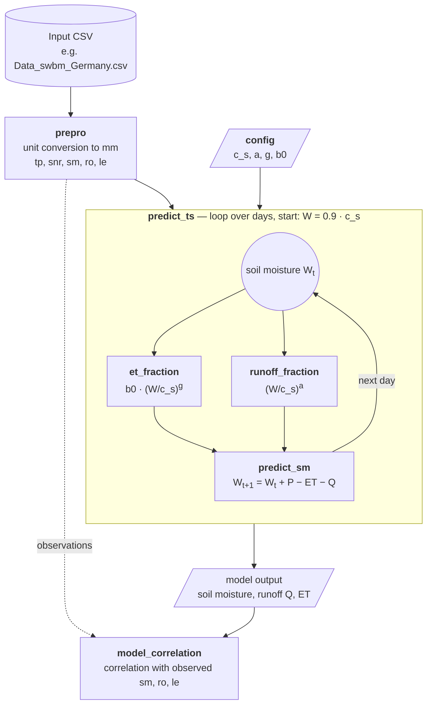

# 🌍 Earth-System-Modelling -> Model

Here you find the most basic version of the Simple Water Balance Model (SWBM):

**First time here?** I recommend starting with the [Python Tutorials](../tutorials/README.md) if you're new to programming. They'll teach you everything you need to understand this model.

**Already familiar with Python?** You can find a complete example workflow for running the SWBM model in:

➡️ [`swbm.py`](swbm.py) — or as a notebook for Colab: [`swbm.ipynb`](swbm.ipynb)

There is also an R version of the model provided:

➡️ [`swbm.R`](swbm.R)

Both scripts load the data directly from GitHub via `DATA_URL`, so they also run in Google Colab. To work offline, point `DATA_URL` to your local `data/` folder.

---

## Features

- 🧹 Preprocessing of input data for the water balance model
- 💧 Simulation of **soil moisture**, **runoff**, and **evapotranspiration**
- ⏱ Easy-to-run time series simulations
- 📊 Correlation analysis between model output and observed data

---
## Input Data

The model requires an input CSV file with the following variables:

📅 time: Date or timestamp

🌐 latitude and longitude

☔ tp_[mm]: Precipitation in mm

☀️ snr_[MJ/m2]: Surface net radiation

Optional: (used for correlation with observations):

🌱 sm_[m3/m3]: Soil moisture

🌊 ro_[m]: Runoff

🔥 le_[W/m2]: Latent heat flux

---
## Configuration

The model uses a configuration dictionary with these example parameters:

| Parameter | Description                      | Example |
| --------- | -------------------------------- | ------- |
| `c_s`     | Soil water holding capacity (mm) | 420     |
| `a`       | Runoff function shape (α)        | 4       |
| `g`       | ET function shape (γ)            | 0.5     |
| `b0`      | Maximum of ET function (β)       | 0.8     |

Python example:

```python
config = {
    'c_s': 420,
    'a': 4,
    'g': 0.5,
    'b0': 0.8
}
```

---
## How the Model Works

Each box is a function; `predict_ts` calls the three inner functions once per day.



Daily water balance, with precipitation $P$ and net radiation $R_n$ (both in mm):

$$W_{t+1} = W_t + P_t - \underbrace{\beta_0 \left(\tfrac{W_t}{c_s}\right)^{\gamma} R_{n,t}}_{ET_t} - \underbrace{\left(\tfrac{W_t}{c_s}\right)^{\alpha} P_t}_{Q_t}$$
